# Draw Your World

Draw Your World 是一个以绘画、自述和记录为核心的 UX 交互原型。用户可以自由画画或摆放几何形状，邀请 AI 一起观察作品，补充自己的解释，确认一份记录，并为这次作品选择一个有趣的名字。界面以英文为主，覆盖电脑、平板和手机布局。

本分支 `design/white-wall-companions` 保存“海报首页＋白墙创作空间＋扁平动物陪伴”的设计与实现，供项目评审和交互演示使用。

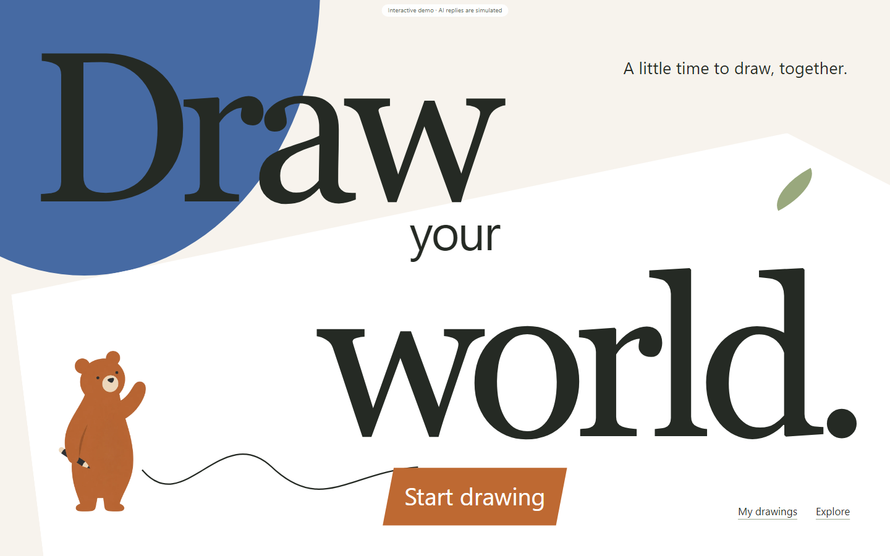

## 一次体验如何完成

**进入首页 → 绘画／拼贴 → 可选 AI 观察与聊画 → 修订并确认记录 → 可选趣味绘画名称 → 保存与回看。**

绘画和聊画都能直接进入保存。用户也可以选择自写记录、跳过自评或名称，再决定是否与专业人士分享内容。

| 环节 | 可以操作的内容 | 用户掌握的选择 |
| --- | --- | --- |
| 绘画与拼贴 | 画笔、橡皮、颜色、粗细、撤销／重做、清空确认、PNG 下载，形状拖动／缩放／旋转 | 新作从空白开始，两个创作模式可以切换 |
| 观察与聊画 | 识别可见对象，围绕作品交流，查看完整对话，放大原作 | AI 处理需要明确允许，含义由创作者补充或纠正 |
| 记录与回顾 | 编辑总结，填写可选自评和随记，确认自己的记录 | 保存画作记录与保存原始聊天分别选择 |
| 当次绘画名称 | 16 个趣味名称与原创四字母代码 | 可改选或跳过，名称只随本次作品保存 |
| 作品历史 | 标题、画作、记录、原作查看、另起副本、下载／删除，周月年回顾 | 已保存的原作保留，修改后建立新版本 |
| 专业支持 | 示例服务资料、费用与时间、文字／语音／线下预约流程、分享预览与撤回 | 单独选择画作、确认记录及后续访谈意愿 |
| 其他探索 | 匿名笔记的预览、确认与移除，昵称与本地数据说明 | 所有侧线都可返回主要体验 |

真实模式连接 DeepSeek 完成观察、对话、总结和名称建议。演示模式会显示 `Interactive demo`，使用脚本回应。专业服务、预约、费用、匿名笔记和沟通方式均提供本地演示状态。

## 主要界面

以下是本地生产版本的实际运行截图，拍摄于 2026-11-17。示例画作通过页面里的真实画笔绘制，文字采用演示内容，截图中的 Demo 标识保留在画面上。

### 绘画与聊画

白墙工作区把作品放在视觉中心，工具集中在下沿。真正的绘图区使用固定坐标，导出的图片保持纯白底。进入聊画后，同一幅作品缩小到上方，对话在下方展开，返回时恢复绘画视图与工具。

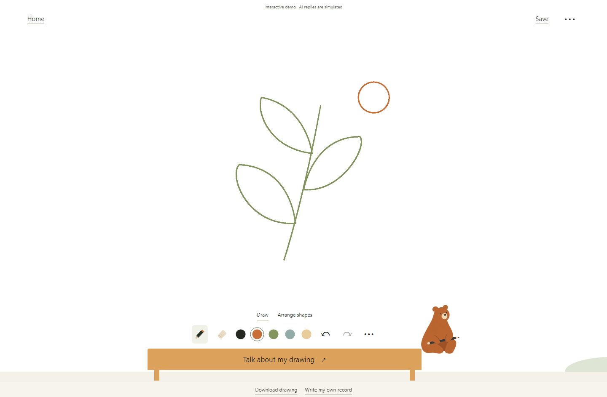

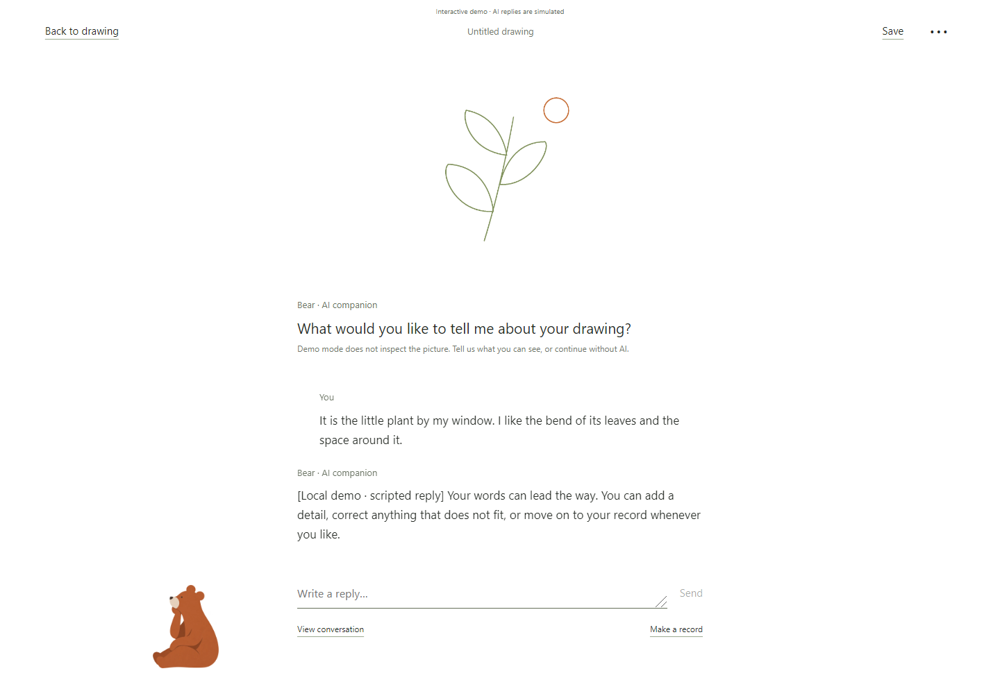

进入聊画前，用户分别选择 AI 处理与后续保存许可。[查看许可页](./docs/screenshots/white-wall/permission-desktop.png)

### 修订记录与当次趣味名称

用户可以改写总结，确认自己的表达，再选择或更换这次作品的名称。四字母代码使用独立字母组合，16 个名称地位相同。名称依据本人确认的记录提出，用户可以直接跳过。

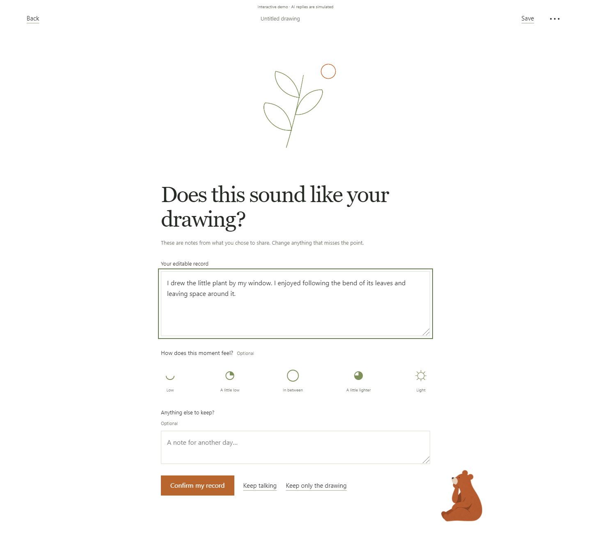

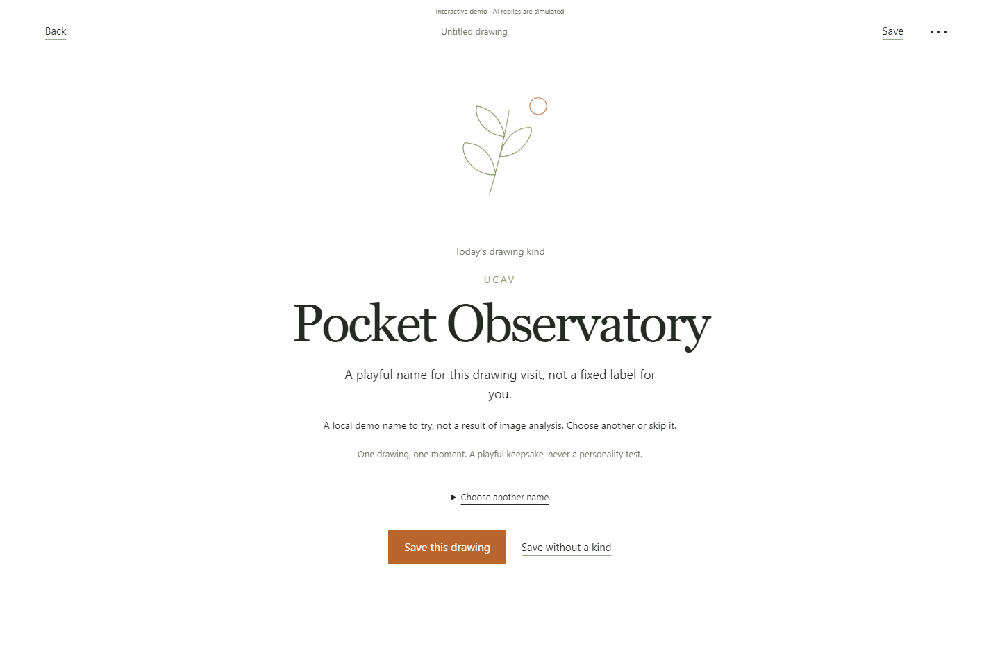

### 保存与回看

保存前展示标题、保存位置与项目选择。原始聊天有独立选项。作品库保留画面和日期，用户可打开记录、查看提交原作，或从旧作继续创作一个副本。

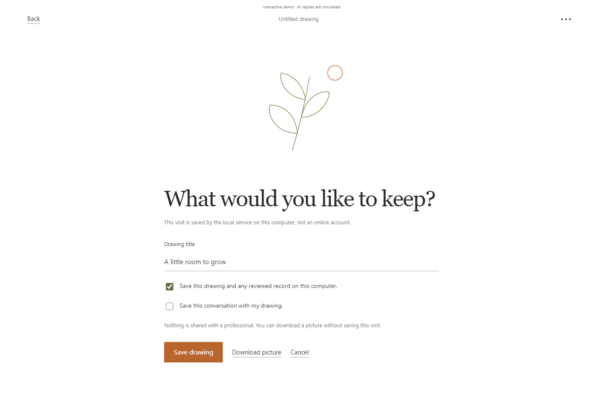

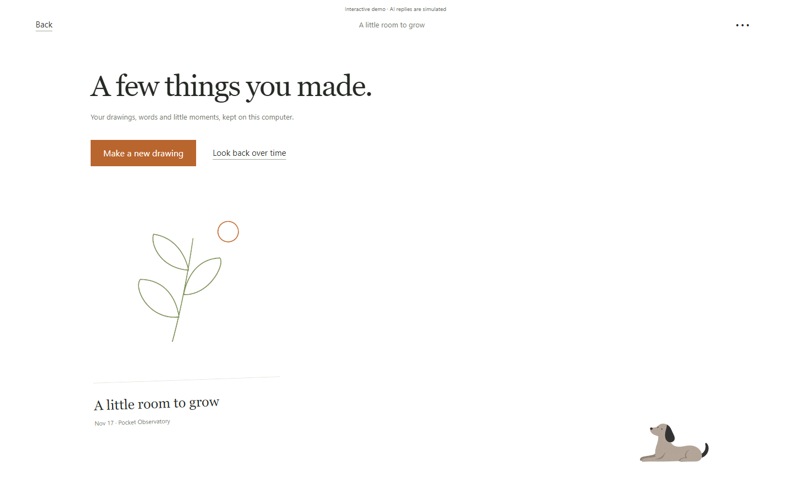

保存完成后显示目的地，并提供继续绘画和回看入口。[查看保存完成状态](./docs/screenshots/white-wall/saved-desktop.png)

### 主动分享与专业端预览

用户先看见接收方及完整预览，再确认分享范围。专业端按已选字段展示画作和本人确认的记录。撤回或内容版本变化后，旧分享失效。专业端目前通过同一匿名会话提供本地预览。

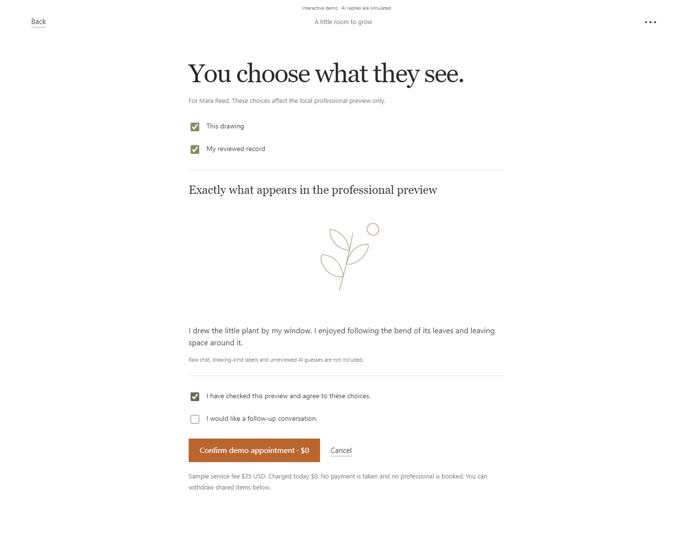

<details>
<summary>查看专业端的对应画面</summary>

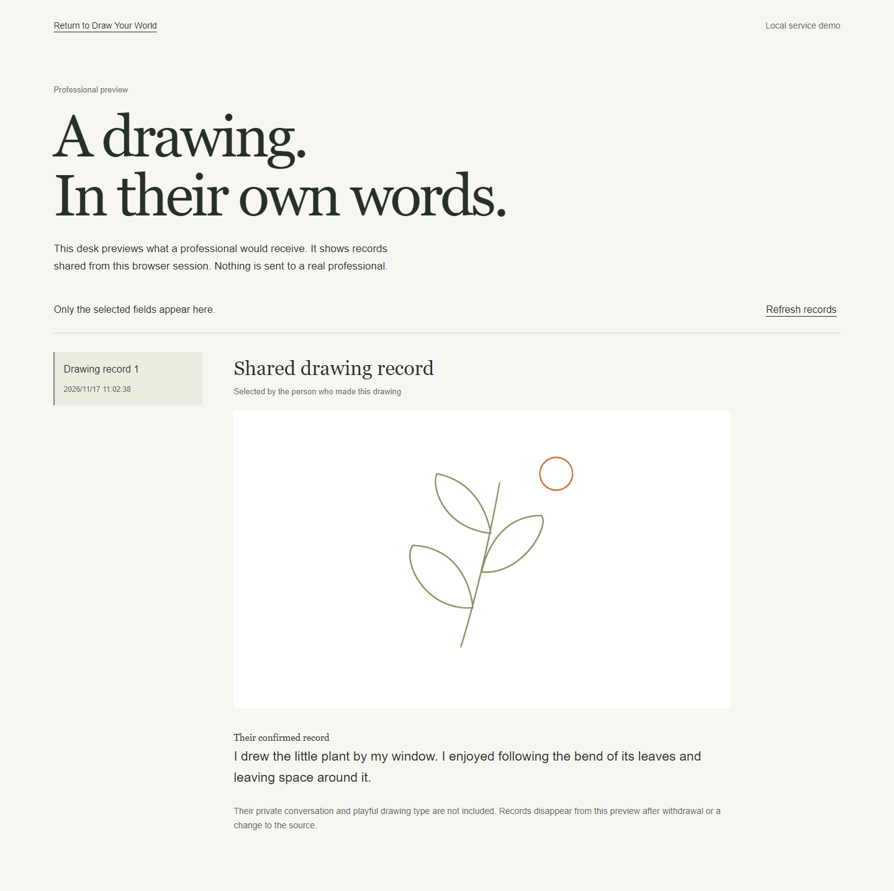

</details>

### 手机布局

手机重新安排首页的大小字、纸面和角色。聊画使用纵向布局，输入时根据可用视口收拢预览和装饰。已在桌面浏览器检查 390、360 宽度及短视口，真实 iOS／Android 键盘仍需实机验证。

<p>
  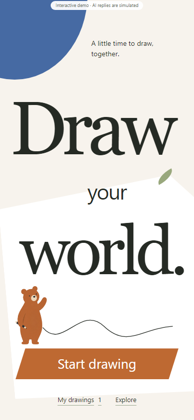
  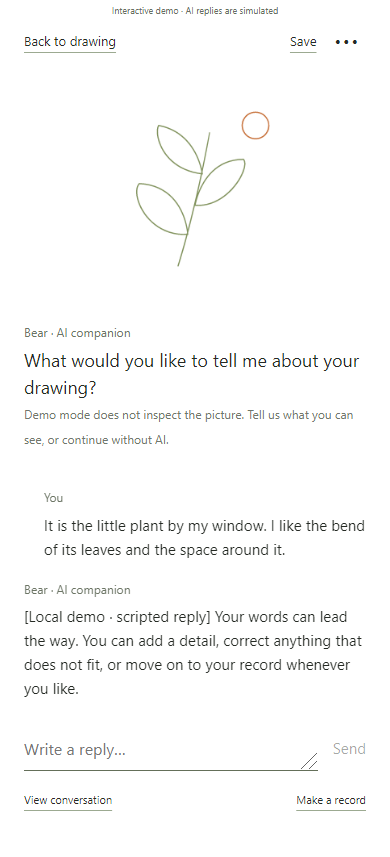
</p>

## 设计方案与设计思考

本版继续探索温暖、有艺术感、留白充分且操作直接的绘画体验。上一轮邮局小镇的功能覆盖为本版提供了流程基础，这一轮把主题集中在创作空间和动物陪伴上。

| 我们关注的问题 | 本版设计决定 | 希望进一步验证的体验 |
| --- | --- | --- |
| 首次进入能否理解要做什么 | 首页采用海报构图，巨幅标题形成层级，突出 `Start drawing` | 用户是否能直接开始，次要入口是否容易找到 |
| 用户怎样持续看见自己的画 | 白墙空间中保留完整画作，工具落在边缘，聊画时等比调整预览 | 切换状态后能否辨认同一作品，并继续原来的笔迹 |
| 温暖感怎样融入操作 | 熊以问候、安坐、倾听和捧纸姿势回应阶段，狗出现在历史页 | 角色能否帮助理解状态，是否分散创作注意力 |
| 艺术构图怎样适应不同屏幕 | 桌面利用横向留白，手机重排字面和工具，取消绘画页蓝色侧条，以米白、赭色和鼠尾草绿呼应 | 小屏操作、短视口输入与长文本是否清楚可达 |
| AI 的整理怎样允许用户修正 | 可见观察、用户消息和 AI 回应标明来源，总结经过编辑和确认 | 用户是否愿意纠正、是否理解记录形成的过程 |
| 保存和分享怎样让人看明白 | 设置分别的保存选项，分享前显示所选内容，授权绑定作品版本 | 用户能否准确说出保存了什么、交给谁看了什么 |
| 有趣的名称怎样保持轻松 | 每次作品使用可更换的趣味名称，允许跳过 | 用户是否觉得有趣，是否理解它只属于这次作品 |

这些是当前设计假设。已有实现和浏览器走查支持继续评审，下一步可以通过真实用户任务测试验证开始绘画、纠正记录和分享选择的理解情况。

### 参考来源

| 参考 | 原项目的做法 | 我们的应用 |
| --- | --- | --- |
| Studio Feixen《Luzern Poster》 | 用倚靠墙面的海报平面组织画面，形成向空间展开的效果 | 借鉴平面间的位置关系，发展首页纸面、白墙和边缘物件的空间构图。[原项目](https://www.studiofeixen.ch/luzern-poster/) |
| Graphic Thought Facility《Robert Rauschenberg: Jammers》展册 | 宽裕页面与克制排字回应作品的尺度和色彩 | 让作品拥有主要面积，将说明安排为画面下方的短文字。[原项目](https://graphicthoughtfacility.com/gagosian-robert-rauschenberg-jammers/) |
| 本项目邮局小镇探索 | 完整尝试了地图入口、画桌、信件、收藏与支持流程 | 延续可返回的交互关系和明确的内容选择，将新主题放入创作与回看环节。[历史记录](./docs/little-post-archive.md) |

巨幅字号层级、成熟扁平动物及本版主题来自项目讨论中的设计需求。上面的案例用于研究构图原则。熊、狗及设计方向图使用内置 imagegen 为本项目生成，页面布局、文字、表单与画布通过 React、CSS 和 Canvas 实现。生成简报与素材记录保存在设计目录中。[生成记录](./design/v4/generation-notes.md)

当前 UI 规格、生成参考图和实际走查分别可供核对。[UI／UX 规格](./design/v4/ui-spec.md) · [实施参考图](./design/v4/implementation-board.png) · [视觉走查](./design/v4/visual-review.md) · [流程覆盖](./docs/next-experience-requirements.md)

## 本地启动

需要 Node.js 22.13+ 与 npm，数据库采用内置 `node:sqlite`。

Windows 可以双击 `启动白墙演示.cmd` 体验完整本地演示，或使用 `启动画室.cmd` 连接 `.env.local` 中配置的真实 AI。`停止画室.cmd` 负责关闭一键入口启动的服务。切换模式或更新源码后，先停止再启动。

```powershell
npm install
npm run demo
# 配好 .env.local 后运行真实 AI
npm run dev
```

访问终端给出的地址，默认是 http://127.0.0.1:3000。启动器会根据可用端口调整地址，并在源码变化后重新构建。

| 配置 | 用途 |
| --- | --- |
| `DEEPSEEK_API_KEY` | 服务端调用模型的密钥 |
| `DEEPSEEK_BASE_URL` / `DEEPSEEK_MODEL` | 可选服务端点和模型配置 |
| `STUDIO_MODE` | `live` 或 `demo` |
| `STUDIO_DATA_DIR` | 本地 SQLite 保存目录 |

从 `.env.example` 创建 `.env.local` 并填入自己的配置。密钥通过服务端环境变量读取。Git 忽略本地环境文件、数据库、运行日志和测试输出。

## 实现与当前验证

前端使用 Next.js、React、TypeScript 与 Canvas，后端使用本地 Node 服务和 SQLite。保存记录通过匿名 HttpOnly Cookie 关联，作品保存与原始聊天保存有各自选项。未保存草稿保留在服务进程内存中，重启服务后需要重新开始。继续查看同一作品库需要保持相同浏览器与访问来源。

- `/` 提供本版白墙体验。
- `/professional` 提供已授权内容的专业端本地预览。
- `/little-post` 保留上一轮小镇探索。
- `/studio` 保留更早的连接式画室供比较。

本版流程覆盖绘画、可选 AI、自述与记录、趣味名称、回看及后续支持。视频生成从本版流程中移除，历史媒体任务的 worker 通过显式命令启动。

当前专业端、预约、费用、文字／语音／线下沟通和匿名笔记使用本地演示状态。真实手机键盘、手写笔与触摸设备的实机测试尚待完成。

已通过 66 项自动测试、TypeScript 检查和生产构建。使用示例画作验证了真实 API 的观察、对话、总结与名称建议，并完成生产页面的保存回看、失败重试、重复点击、字段过滤和撤回走查。[验收记录](./docs/white-wall-validation.md)

```powershell
npm test
npm run typecheck
npm run build
# 脚本演示检查
node --import tsx scripts/check-wall-api.ts
# 使用自己的服务配置执行真实 API 检查，会消耗模型额度
node --env-file-if-exists=.env.local --import tsx scripts/check-wall-api.ts --live
```

浏览器流程检查脚本位于 `scripts/browser/`，开发技能快照位于 `.agents/skills/`。修改代码前遵循项目 `AGENTS.md` 和当前安装版本的 Next.js 文档。[技能来源](./.agents/skills/README.md)
