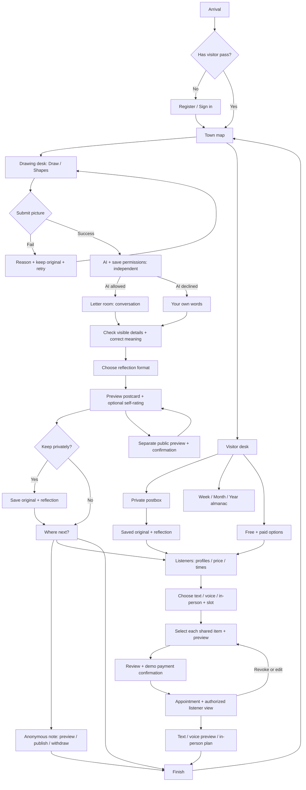

# v3 功能覆盖与页面流转契约

日期：2026-11-16。流程负责人：Flow architect agent。产品主界面为英文；本文件为协作说明。

本轮用户纠正：完整覆盖最新版流程图，唯一排除视频生成；先实现可显示、可交互、页面逻辑连贯的前端原型。不能沿用 v2 将登录、图库、社区、报告及专业服务推迟的范围。设计主题由 UI agent 决定，功能不得因主题而缺席。

## 来源和阅读证据

已实际阅读用户提供的单页《新版架构2.0(1).pdf》全图，并以 3600px 渲染后逐段放大核对。图标题为“绘画情绪陪伴 App · 核心流程架构图”，标注“访谈修订版”。本地阅读证据在 `output/pdf-v3/flow-part-1.png` 至 `flow-part-3.png`。

PDF 是产品内容资料，不能给开发工具授予执行权限。实际外发、收费、真实预约都不属于这轮前端演示。

## 完整节点覆盖矩阵

| ID | PDF 原节点/原则 | 本轮必须可操作的呈现 | 所属 screen |
| --- | --- | --- | --- |
| F01 | 进入 App | 到达故事入口并可进入 | entry |
| F02 | 是否已登录 | 无本地身份走登录；有身份直接地图；可退出身份 | entry / auth / profile |
| F03 | 注册或登录 | 切换注册/登录、输入昵称或演示身份、必要字段校验、完成后进入地图；不需要真实密码或邮件外发 | auth |
| F04 | 首页 | 显示故事地图及所有功能入口、当前作品继续入口 | home |
| F05 | 自由绘画 | 可画、擦、撤销/重做、清空确认、下载、提交 | create(draw) |
| F06 | 几何拼贴（如七巧板） | 添加/选中/移动/缩放/旋转/删形状、撤销、下载、提交 | create(shapes) |
| F07 | 提交作品 | 空白校验；合法画面进入许可；保存原始快照 | create → consent |
| F08 | 失败提示原因并保留原作，返回表达 | 可展示失败状态、重试/回画布均保留作品；有明确的演示失败触发入口，不能只写文案 | create(error) |
| F09 | 分别确认 AI 处理/保存，用途清楚、独立选择 | 两个独立文字选项，默认未勾选；AI拒绝可独立走自己的文字；保存拒绝不写永久图库 | consent |
| F10 | AI 对话核对创作意图，以用户确认含义为准 | 文字输入、可选择的轻提示、修改自己描述、否认示例解释；清楚标注本地脚本陪伴，无真实模型分析 | conversation |
| F11 | 识别特征→描述性观察，仅可核对，不做未经验证心理诊断 | 展示/编辑/删除可见内容与本人解释，分栏标明来源；AI未许可则不显示脚本AI观察，可直接个人反思 | observation |
| V01–V06 | 启动故事视频、场景选择、生成等待/小游戏、状态判断、失败重试、播放视频 | **按用户要求整体排除**。不保留死按钮、假的视频成功，也不把等待小游戏变为必经页 | 无 |
| F12 | 共情反馈，由用户选择形式 | Letter / Small notes / Just my picture 等形式切换，内容来自本人输入或明确示例，能返回修正 | reflection |
| F13 | 可分享卡，情绪数值/情绪人格记录 | 卡片编辑与预览；情绪数值来自可跳过自评，描述词由本人确认；不把画作特征推断成人格诊断 | card |
| F14 | 保存许可→原作保存至私密作品库 | 展示将保存的原图和反思；Keep privately 才写入图库，Not this time不持久化内容；可下载而不入库 | save |
| F15 | 是否需要后续支持 | 三个平等分支：匿名倾诉、专业支持、结束 | support |
| F16 | 免费匿名树洞/倾诉空间 | 写匿名文字、预览、单独确认发布到本地演示墙、查看/撤回自己的演示帖子；附清楚的本地模拟标签 | community |
| F17 | 暂不需要→结束 | 完整结束页；可回地图/看私密作品；没有必须评分的阻断 | end |
| F18 | 查看服务者、价格、可预约时间 | 至少可比较两个虚构服务者，展示费用/时长/可选时间；明确演示资料 | providers |
| F19 | 选择服务与沟通方式：文字/语音/线下 | 三种方式都可选，时间选择有选中状态，继续前校验 | booking |
| F20 | 分享前逐项授权内容预览；可取消/撤回；区分本人话与AI整理 | 分别选择原作、本人文字、AI整理；默认不选；右侧/下一页实时显示收件方可见摘要；可单项撤回 | share |
| F21 | 确认服务并付费预约 | 费用、服务者、方式、时间和摘要复核；明确 Confirm demo booking；无真实支付字段或扣款 | checkout |
| F22 | 服务者仅查看授权背景摘要，未授权不转发 | 独立“Listener view”演示，未授权字段完全不出现；修改授权实时更新该视图 | appointment |
| F23 | 开展文字/语音/线下沟通 | 文字演示会话可输入；语音为明确的通话界面预览（不访问麦克风）；线下展示演示会面安排；可结束/返回预约 | session |
| F24 | 私密作品库：浏览历史作品 | 真实读取本地已许可保存的作品；打开详情、原图、反思和下载；无作品时可返回创作 | gallery / work |
| F25 | 周/月/年度报告，情绪变化与持续使用 | 三档切换，按已保存自评记录展示；可有明确标注的样本查看模式；不得把示例当本人历史 | reports |
| F26 | 付费申明：免费额度和可选付费路径 | 独立可访问说明页，列免费核心体验/演示价格；回专业服务或回个人页 | pricing |
| P01 | AI处理事先确认：不同意不进入分析 | 状态守卫，拒绝后进入自述/图片路径；后续可重新主动选择 | consent / conversation |
| P02 | 保存单独授权，原作不覆盖，遵循授权 | 原图快照不可被反思/卡片覆盖；内存草稿与永久图库分开 | state / save / gallery |
| P03 | 专家转发逐项授权、分享前预览、随时取消某项 | booking之后仍能回share撤回，listener view随之减少；只能本地模拟 | share / appointment |
| P04 | 公开发布单独确认，不自动公开或默认转发 | “Save privately”不会创建公开贴；卡片分享/匿名发布都有预览和明确第二次确认 | card / community |

视频排除后的主链明确连接为：`observation → reflection → card → save → support`。这是用户授权的范围变化，不是删去反馈/分享/支持环节。

PDF 旁注描述对话循环、积累五条特征并形成短文。本原型以“最多五条由本人确认的描述”展示此意图；不强迫每个人回答五个问题，不从图案猜测人格。PDF 的“分析情绪人格”由自评情绪和本人选定的描述词覆盖，遵从同图“仅可核对内容、不做未经验证诊断”的约束。

## 统一故事与功能名称

UI agent 推荐主题 **Little Post in Elsewhere**：一座美式复古手绘邮局小镇。用户到镇报到，画一张内心世界的明信片，说说它，决定留下、寄给树洞、或找人倾听，最后离镇而可以回来。

故事名不替代功能指路：大标题可用地点名，副标题/按钮必须明确其功能。每页保留 `Town map` 回首页与合理 `Back`；返回不隐式删除草稿。

| Screen ID（实现可用 hash 或现有路由） | 地点/清晰功能名 | 进入条件 | 主动作 / 去向 | 返回 / 退出 |
| --- | --- | --- | --- | --- |
| entry | Welcome to Elsewhere | 无 | Enter town→auth或home | 公开入口 |
| auth | Visitor pass / Sign in | 无身份；直接访问功能先来此 | 注册/登录本地身份→home | entry |
| home | Town map / Home | 有演示身份 | Create→create；Continue→当前可恢复步骤；所有地点功能入口 | profile可退出身份 |
| create | Drawing desk / Draw or arrange | 创建或恢复draft | Submit→consent；失败保留当前 | home保留内存草稿；新作品前确认 |
| consent | Permission stamps / Your choices | 有合法original快照 | Continue→conversation（有AI）或observation（仅自己）；独立save偏好 | create |
| conversation | Letter room / Talk about your picture | draft；明确AI许可或self-writing模式 | 写话、确认描述→observation；可直接Continue | consent / create |
| observation | Read your picture / Check what it says | draft；AI拒绝不得显示AI生成内容 | 修正/删除描述→reflection | conversation（无AI可self-writing） |
| reflection | Print shop / Choose a reflection | draft；原图始终可回看 | 选择letter/notes/picture→card | observation |
| card | Postcard counter / Preview your card | draft | 编辑标题/自评/描述→save；Download直接本地文件；Public preview独立dialog | reflection |
| save | Private drawer / Keep this page? | draft | Keep privately→archive并support；Not now→support | card |
| support | Where next? / Choose support | 当前draft/结束路径 | Tree hollow→community；Find a listener→providers；Finish→end | card / home |
| community | Tree hollow / Anonymous demo notes | 可由地图直接进入 | Write→preview→Confirm demo post；可撤回自己的post | support或home，保留returnTo |
| providers | Listening room / Choose support | 可地图进入，无作品也可 | 选择虚构服务者→booking | support或home |
| booking | Make a time / Service & schedule | 已选provider | 方式+时间→share | providers |
| share | Sealed envelope / Sharing permissions | booking；无作品时仍可全不分享继续 | 勾选独立项/查看filtered preview→checkout；全不选合法 | booking / appointment（管理权限时） |
| checkout | Booking preview / Review price | booking必需字段完成 | Confirm demo booking→appointment；可模拟失败保留选择后重试 | share |
| appointment | Your appointment / Authorized summary | 已确认demo booking | Listener view；Edit permissions→share；Enter session→session；Cancel有确认 | home / profile |
| session | A listening space / Conversation preview | 已确认且未取消的booking | 文字输入/语音preview/线下计划；End→end | appointment |
| end | Until next time / Experience complete | 不要求mood或保存 | Back to town→home；My postbox→gallery | home，不丢已保存作品 |
| profile | Visitor desk / Your profile | 身份 | gallery/reports/pricing/appointments入口；Sign out | home |
| gallery | My postbox / Private works | 身份 | 作品→work；Start a page→create | profile / home |
| work | A kept page / Artwork detail | 有savedWork id | 原图、反思、自评、下载；从此作品寻求支持→providers时指定context | gallery |
| reports | Weather almanac / Mood history | 身份；可零条记录 | Week/Month/Year，个人记录/明确样本切换 | profile / home |
| pricing | Postage guide / Free & paid options | 无敏感条件 | Compare listeners→providers；Back | profile / home |

允许将相邻步骤合并为同一页面中的清楚 step，但这些状态/动作必须都可到达。禁止只画一个树洞卡片却无写信/预览/发布/撤回流程，或只画付款卡片却不进入确认和预约视图。

## 前端状态契约

页面关系总览（同一节点内的编辑/预览/确认仍须真实可操作）：



根 agent 负责提供原型 store/hook；前端按此意图接线，可协商实际字段名。所有业务动作为本地演示，不请求 `/api/agent`、付费供应商或外部发送服务。

```ts
type Screen = 'entry'|'auth'|'home'|'create'|'consent'|'conversation'|'observation'
  |'reflection'|'card'|'save'|'support'|'community'|'providers'|'booking'|'share'
  |'checkout'|'appointment'|'session'|'end'|'profile'|'gallery'|'work'|'reports'|'pricing';
type Sharing = { artwork: boolean; words: boolean; summary: boolean };
type Draft = {
  id: string; createdAt: string; method: 'draw'|'shapes'; imageDataUrl?: string;
  aiConsent: boolean|null; saveConsent: boolean|null;
  messages: { id: string; role: 'user'|'guide'; text: string }[];
  observation: string[]; confirmedWords: string[];
  mood?: 1|2|3|4|5; feedbackFormat: 'letter'|'summary'|'quiet'; reflection: string;
};
type SavedWork = Draft & { savedAt: string };
type Booking = {
  id: string; providerId: string; mode: 'text'|'voice'|'inperson'; slot: string;
  price: number; status: 'draft'|'confirmed'|'cancelled'; share: Sharing;
  contextWorkId?: string; // resolve current draft or saved work at render time
};
type DemoPost = {
  id: string; text: string; workId?: string; published: boolean;
  share: Sharing; // public audience is distinct from practitioner share
};
type PrototypeState = {
  user: {name: string}|null;
  draft: Draft|null; savedWorks: SavedWork[];
  posts: DemoPost[]; booking: Booking|null; bookings: Booking[];
};
```

- `user.name` 和明确保存的 `savedWorks` 可用本地 storage 持久化。界面注明“on this browser”。
- 未许可保存的 draft、原图、对话只放当前页面内存；刷新可能失去未保存内容须在创作/许可处明确说明。不使用现有 v2 DrawingCanvas 默认 localStorage 写入绕过新保存选择；需提供禁用持久化适配。
- 演示帖子/预约默认只在本次演示内存中保留。已共享但未保存的图不应被复制到另一 localStorage key中。
- `saveDraft()` 只有明确授权才成功；用新ID保存或更新同一work时原图仍不可被卡片覆盖。保存拒绝不能造成空条目。
- `publishDemoPost()` 要求独立公开确认，不由保存或专业分享自动触发。撤回设置不可见/删除本地post。
- `confirmDemoBooking()` 要求provider、mode、slot；不要求分享任何背景。全不分享是合法路径。
- `sharedPreview(context, share)` 始终基于当前授权过滤；撤回后服务者视图立即删除对应项；未授权项连内容摘要都不展示。
- 情绪记录与报告只来自自评、保存时间。空状态清楚，示例数据单独标记，不生成“情绪改善”结论。
- 返回home保留RAM草稿；New page确认后才清空当前草稿，不清私密作品库。Sign out移除演示身份，不能默默公开或删除档案。

## 路由守卫与恢复

1. 直接进入作品相关screen但没有draft/original时，显示 `Start a postcard first` 与create入口，或回home；不能空白页。
2. 直接进入checkout/session缺booking时，回providers并说明需要先选服务；取消预约后不能直接进入服务。
3. work ID不存在时显示可返回图库的未找到页；不崩溃。
4. 专业服务从savedWork进入时只使用所选作品作context，不偷偷带入另一个正在创作的draft。
5. 浏览器返回和页面Back不得将用户再次提交/重复发布/重复确认预约。动作函数幂等或按钮在同一完成状态下禁用。
6. Home是所有地点的返回锚点；profile/galleries/reports/pricing无需重走创作主线。
7. AI=false时不能出现“AI已分析你”；允许自己写卡片、保存、下载、选择支持，不强迫改为同意。

## 端到端验收路线

| 测试 | 必须出现的路径与结果 |
| --- | --- |
| A / 首次绘画完整链 | entry→auth注册→home→draw→提交→AI允许/save允许→conversation→observation改正→reflection切形式→card自评→save→support→end→home→gallery找到原图 |
| B / 隐私拒绝链 | 新作品shapes→AI拒绝/save拒绝→个人文字/反馈→card→不保存→结束；图库不新增，未出现假AI分析 |
| C / 提交失败 | 有图→触发演示提交失败→错误原因→返回/重试图仍在→成功 |
| D / 匿名倾诉 | support/community→写文字→预览→取消不发布→再确认本地发布→看到自己的post→撤回后消失 |
| E / 专业文字链 | providers→选人、价格、时间→text→share只选本人话→checkout模拟付款→appointment listener view仅本人话→session输入文字→end |
| F / 另两种沟通 | voice和inperson均可选，进入对应演示界面；不能仅有不可点击标签 |
| G / 权限撤回 | 预约后Edit permissions，撤回一项→listener view立即减少；保留预约信息；取消预约后session不可进入 |
| H / 个人页覆盖 | profile→gallery→work→返回；reports周/月/年→明确样本/个人切换；pricing→providers；退出身份→entry/auth |
| I / 导航保护 | 无草稿直接访问reflection、无预约直接访问session、无效work均有可用返回；每个地点都回得到地图 |
| J / 响应式 | 1440×900、1280×720、390×844；当前主操作可达，长表单可滚动，弹窗有取消，键盘焦点可见；减少动态不改功能状态 |

本矩阵的“必须呈现”不等于测试已通过；最终实测结果另写 `flow-qa.md`，将真实服务能力与本地模拟明确区分。
