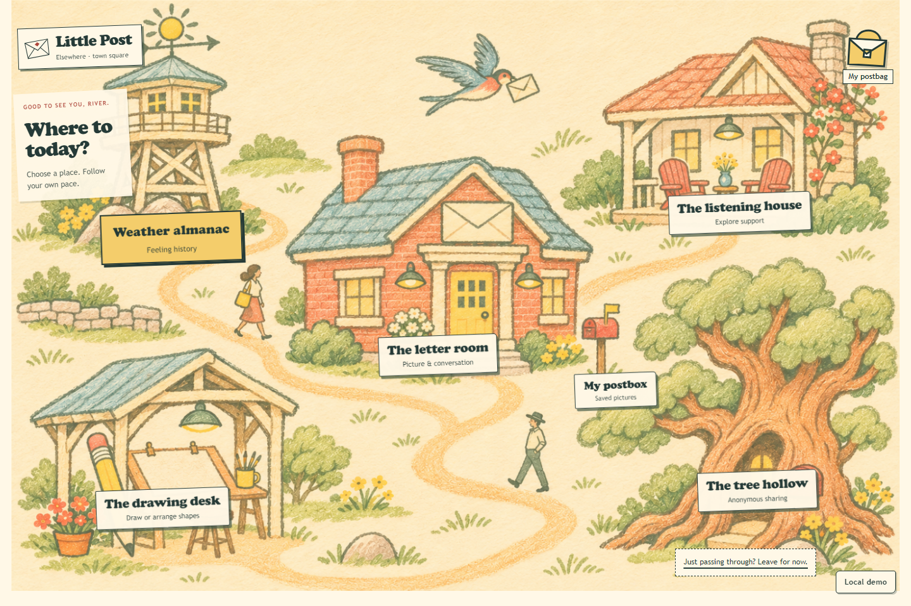
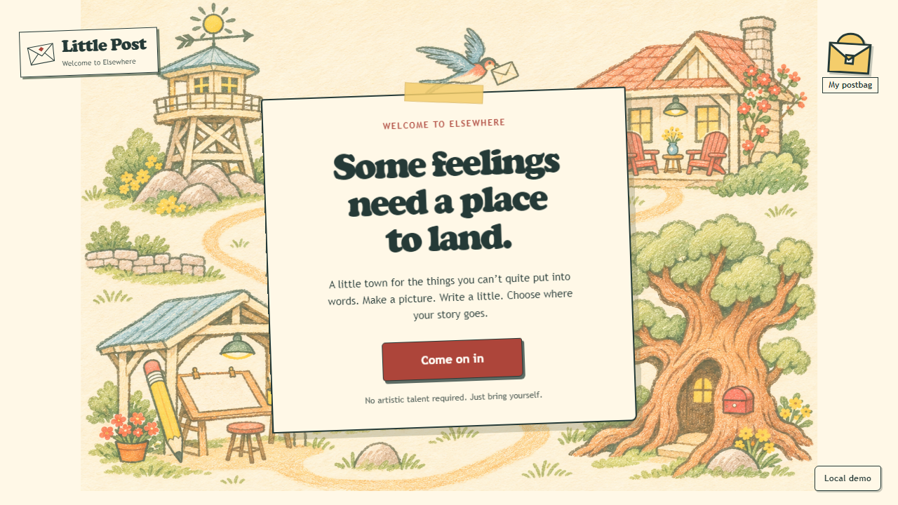
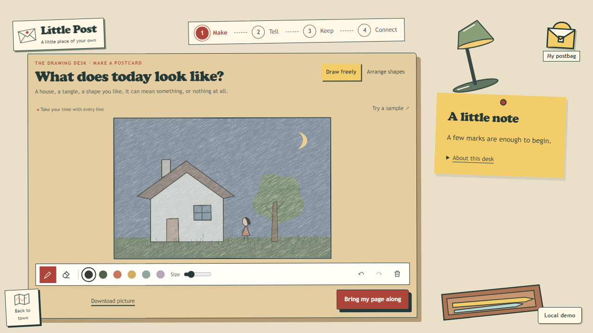
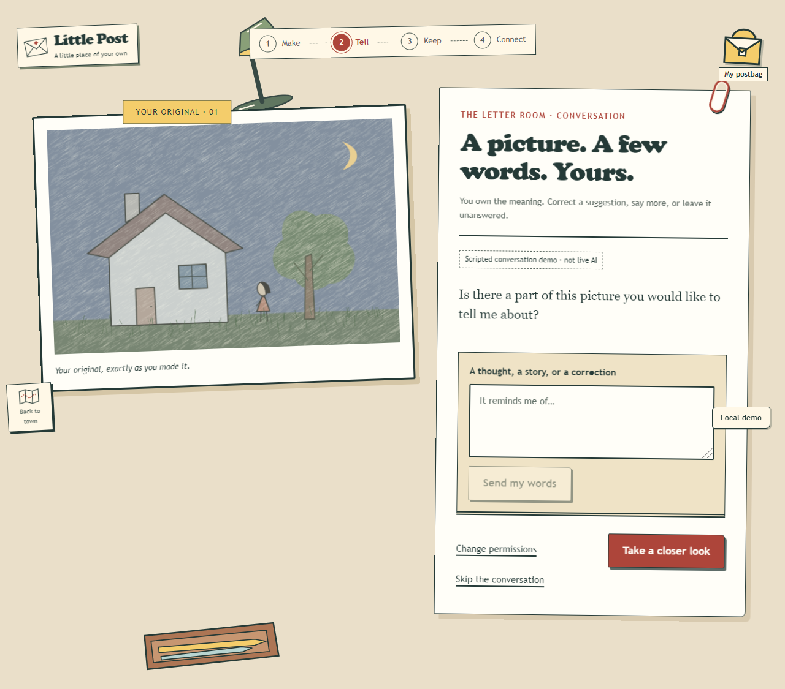
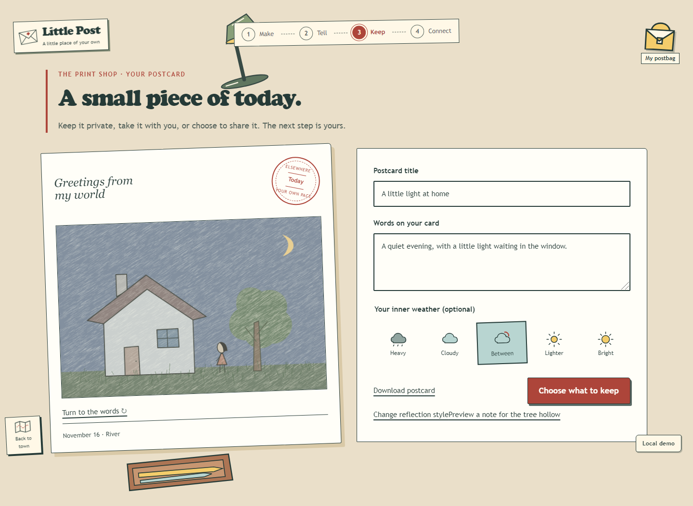
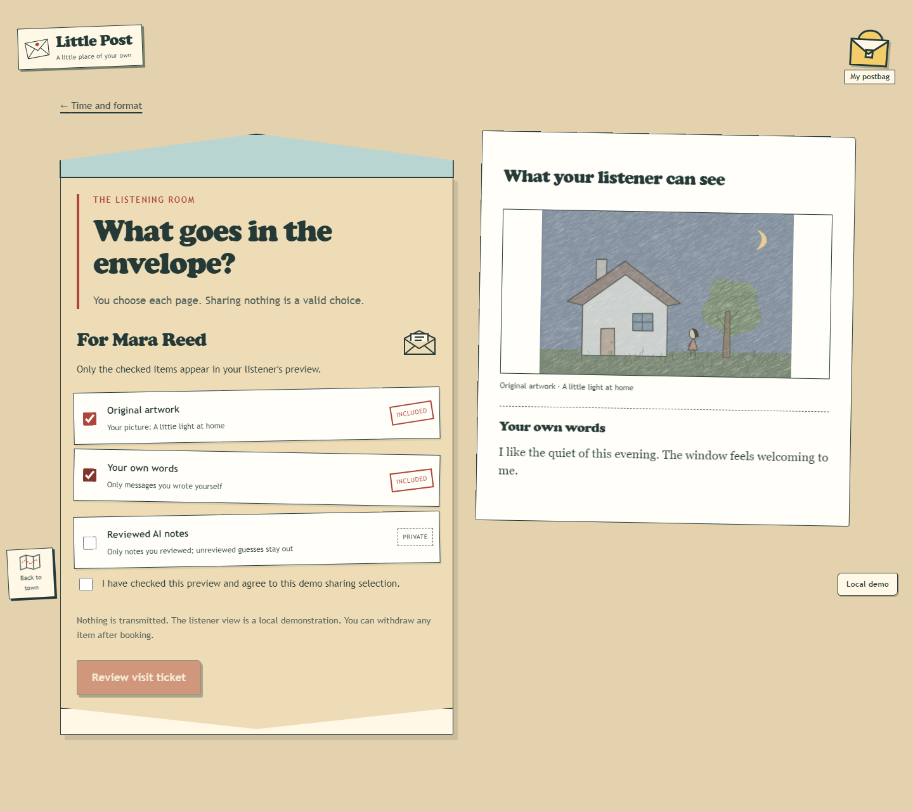

# Draw Your World · Little Post

电脑优先、英文界面为主的绘画与自我表达交互原型。当前首页是 **Little Post in Elsewhere**：进入一座美式复古手绘的邮局小镇，在画桌创作、信笺间叙述，再决定把作品留在私人信箱、投向树洞，或带去倾听室。

**这是一次 UX 设计探索快照，不代表最终产品形态。** `design/little-post-storybook` 分支保存“邮局小镇＋柔和彩铅绘本”的完整尝试，用来讨论场景叙事能否帮助用户表达、理解选择并掌握分享边界。视觉上的温暖不是疗效证明；当前阶段优先验证流程与交互。



本轮按照最新架构图覆盖除视频生成外的完整前端流程，采用场景和可操作物件组织交互。功能与页面跳转见 [flow-spec.md](../design/v3/flow-spec.md)，故事、竞品依据与视觉要求见 [theme-spec.md](../design/v3/theme-spec.md)，功能符号与主题设计理由见 [design-rationale.md](../design/v3/design-rationale.md)。v1.0 发布标签保持不变。

## 一段体验如何走通

**来到小镇 → 绘画／拼贴 → 分别选择 AI 与保存许可 → 自述、观察与反思 → 制作明信片 → 选择私藏、分享、寻求支持或离开。**

| 小镇中的位置 | 可以做什么 | 关键选择 |
| --- | --- | --- |
| 到访登记 / 小镇地图 | 用演示昵称进入；点击建筑探索不同功能 | 可随时回到地图，不要求按固定顺序访问所有地点 |
| Drawing desk · 创作画桌 | 自由画线、几何拼贴、撤销/重做、下载、提交 | 提交失败保留作品；原作独立保留 |
| Permission counter · 许可柜台 | 分别选择是否进入 AI 辅助流程、是否允许后续私存 | 两项许可独立，拒绝 AI 仍可继续自己的表达 |
| Letter room · 信笺间 | 描述画面、自写观察、纠正或删除不合适的理解、选择反思方式 | 用户拥有作品含义，可以跳过对话或只留下画面 |
| Print shop / My postbox · 明信片与私人信箱 | 编辑标题和文字、选择可选自评、翻面预览、导出 PNG、保存/回看/另存/删除 | 只有明确点击保存才进入浏览器收藏；保存不等于分享 |
| Weather almanac · 回顾册 | 查看周/月/年的已保存感受记录 | 使用用户自己的记录，不从画作推断情绪或诊断 |
| Tree hollow · 树洞 | 匿名短笺预览、本地发布、回复、撤回 | 分享有独立确认；本原型不会真的发布给其他人 |
| Listening room · 倾听室 | 查看示例服务、选择文字/语音/线下、时间与费用、逐项分享、模拟支付及取消 | 只展示被授权的背景；新增内容需重新确认，分享可以撤回 |
| The way home · 归途 | 结束本次体验，或回到小镇 | 结束和不改变都属于有效选择 |

主题物件也承担具体含义：**建筑是去处，邮戳是单项许可，私人信箱是保存，打开的信封是逐项分享，票据是预约承诺。** 这些对应关系及设计取舍记录在 [设计思考](../design/v3/design-rationale.md) 中。

## 实际界面预览

以下均为本地运行的实际界面截图，不是生成的设计稿。画作采用内置示例，昵称与文案为演示内容；截图日期为 2026-11-16。

### 1. 到达：从一张欢迎纸条进入小镇

全景插画与前景纸条构成入口；地图中的建筑继续承担导航，保持同一个故事世界。



### 2. 创作：在画桌上留下自己的画面

画纸、工具托盘和完成操作集中在桌面；可以自由绘画，也可以切换到几何拼贴。图中是主动选择的内置示例。



### 3. 表达：作品与信纸并置

保留原作，让用户补充自己的话、纠正理解或直接跳过。当前首页的陪伴文字明确标为脚本示例，不是实时 AI 回复。



### 4. 留下：制作一张自己的明信片

编辑标题、文字与可选的“内心天气”，翻面查看、导出完整 PNG，再决定是否私存。感受由用户自评，系统不替用户下结论。



### 5. 分享：看清信封里究竟放了什么

原画、用户自己的话、已审阅的示例整理分别勾选；右侧即时显示接收方能看到的内容。什么都不分享也可以继续预约演示。



<details>
<summary>查看手机窄屏示例</summary>

作品和信纸在窄屏按阅读顺序排列，保留完整操作；本轮仍以电脑演示为主要目标。


</details>

精选截图保存在 [`docs/screenshots/little-post/`](../docs/screenshots/little-post/)，已随本分支提交；原始测试截图、日志和用户运行数据不进入仓库。

## 两个入口

- **`/`：小镇交互原型。** 演示登录、绘画/拼贴、独立许可、对话、观察、反馈、明信片、私人收藏、匿名社区、专业服务预约/逐项分享/支付/三种沟通方式、个人页及周月年回顾。不调用模型或外部服务。对话为标注的脚本示例，社区、支付和预约只在本地演示。
- **`/studio`：原有连接式画室。** 保留 Sunlit Studio 界面、Agent、图像编辑和可选视频接口。只有此入口使用后文的服务配置与真实/模拟模式。

小镇只在浏览器保存演示访客名及**显式确认保存**的作品。未保存画作、聊天、树洞内容、预约与沟通记录只在本次页面内存中，刷新后清空。私人信箱最多 30 张；它是浏览器本地收藏，不是账户隔离或云端备份。分享选择不会改变私人保存许可。

## 启动

Windows 可以直接在项目文件夹双击：

- **`启动小镇原型.cmd`**：推荐用于本轮演示。打开小镇首页，沿用已有启动器的安全模拟模式。
- **`启动画室.cmd`**：打开首页，并为 `/studio` 启用真实 AI 模式，沿用 `.env.local` 配置。
- **`启动模拟演示.cmd`**：打开首页，`/studio` 同样为明确标识的本地模拟模式。
- **`停止画室.cmd`**：停止一键入口启动的网页与后台任务，保留作品记录。

首次启动会在需要时安装依赖、构建界面；重复点击会打开已运行的同模式画室。后台进程隐藏运行，日志位于 `.data/launcher/`。切换模式或更新源码后，先停止当前画室再启动，以载入新构建。命令行等价入口为 `npm run launch`、`npm run launch:demo`、`npm run stop`。

需要 Node.js 22.13+（建议当前 LTS；本机 Node 23.5 已验证）与 npm。项目使用内置 `node:sqlite`，不需要另外安装数据库。

```powershell
npm install
# 从 .env.example 创建 .env.local，填写自己的服务端配置
npm run dev
```

打开 http://127.0.0.1:3000 。命令同时启动 Next.js 和独立生成 worker，Ctrl+C 关闭两者。`PORT` 可调整端口。

```powershell
# 不使用任何真实模型服务，界面始终标明模拟模式
npm run demo
# 稳定演示前构建
npm run build
npm start
```

`/studio` 的模拟模式只验证交互、草稿确认、图片任务与恢复：图片结果是带 **DEMO** 标记的原画预览，不声称实际执行编辑；没有伪造的生成视频。真实图片/视频功能必须使用 live 模式并配置相应服务。小镇首页始终是纯前端原型，与启动模式无关。

## 连接式画室 `/studio` 的服务配置

复制 `.env.example` 到 `.env.local`。不要把密钥放到浏览器代码或提交到版本库。

| 配置 | 用途 |
|---|---|
| `DEEPSEEK_API_KEY` / `DEEPSEEK_MODEL` | 对话、可见内容观察；默认 `deepseek-flash` |
| `DEEPSEEK_BASE_URL` | 默认 `https://api.deepseek.com` |
| `DASHSCOPE_API_KEY` / `DASHSCOPE_IMAGE_ENDPOINT` | Qwen 图像编辑，必须对应同一账户区域 |
| `DASHSCOPE_IMAGE_MODEL` | 默认 `qwen-image-3.0` |
| `DASHSCOPE_VIDEO_ENDPOINT` / `WAN_MODEL` | Wan 图生视频；默认 `wan3.0-video` |
| `DASHSCOPE_TASK_ENDPOINT` | 可选；视频查询地址，默认从视频端点 origin 解析 |
| `STUDIO_MODE` | `live`（默认）或 `demo` |
| `STUDIO_DATA_DIR` | 默认项目 `.data`，保存 SQLite、checkpoint 与私有素材 |

端点示例见 `.env.example`。模型、密钥、workspace 与 endpoint 必须按实际供应商控制台配套配置。没有配置的能力在界面标明；失败不转换成成功。

视频默认 5 秒、720P、无音轨、固定镜头。供应商异步生成通常需要分钟级等待，期间可继续聊天。保留手绘和局部变化由提示约束及用户验收共同控制，不保证像素级不变。

## 连接式画室 `/studio` 的交互和数据

- 提交原画后做一次中性观察；失败仍可自述。原画永远独立保留。
- LangGraph `prepare → reason → tools → finish` 负责聊天、记忆与提出草稿；工具无法生成媒体。
- 用户原话、AI 理解草稿、已确认理解、被否认解释分别记录。更正会作废相关旧理解与建议。
- 只有点击当前草稿的确认按钮才创建生成任务。改动画、改原画、选择其他结果后，旧来源的草稿不能执行。
- 图片结果可对照、接受或舍弃；动画不自动播放。重复点击复用同一任务，网络提交状态不明时不自动再次付费调用。
- 匿名 HttpOnly Cookie 绑定本地会话。接口只接受用户事件，不接受前端提交的整份会话。素材必须由所属会话读取。
- 刷新可恢复，数据保存在此电脑；“重新开始”清理旧会话、素材及图记忆。画布未提交草稿暂存在当前浏览器。
- 取消代表停止等待和使用结果，已提交给供应商的任务可能继续执行。供应商副本不受本地删除控制。

连接式画室按本机单实例演示实现，不提供真实账号、公开分享、专业人员工作台、社区或支付。小镇首页涵盖这些功能的前端状态与逻辑，仍未连接相应后端。产品不作诊断或疗效承诺。

## 验证

```powershell
npm test
npm run typecheck
npm run build
# 使用 .env.local 实际调用识图与三轮 Agent 对话（会消耗供应商额度），仅上传程序生成的测试画
npm run check:api
# 以下参数另行调用真实图片/视频，需先配齐对应服务
npm run check:api -- --image --video
```

API 检查报告只记录成功/失败、耗时和数量，保存在 `.data/checks/latest.json`，不记录凭据或服务原始响应。浏览器走查截图保存在 `output/playwright/`。

当前验证结果与真实生成边界见 [VALIDATION.md](../VALIDATION.md)。切换 Live/Demo 时会开启对应模式的新会话，另一模式的本地记录与队列保留且不会被当前 worker 执行。

测试覆盖原作保留、源版本校验、生成确认、重复请求、取消与旧结果、模拟标识、缺配置失败、会话隔离、跨源请求、动态工具草稿、用户纠正及 SQLite 恢复。真实模型的措辞、识别与手绘保真还需由实际体验验证。

## 开发资料

原始交接见 [prdv0.1.md](../prdv0.1.md)。旧 `src/lib/harness` 作为历史实现与基线测试保留；连接式画室使用 `src/lib/studio`，小镇状态位于 `src/lib/prototype`，交互组件位于 `src/components/prototype`。修改 Next.js 前按 `AGENTS.md` 阅读当前安装版本的本地文档。

项目技能仓库位于 [`.agents/skills/`](../.agents/skills/README.md)，包含 `frontend-design`、`vercel-react-best-practices`、`playwright`、`imagegen` 的完整快照与来源校验记录。它们不会成为应用运行依赖。

界面采用设计图先行的流程：场景参考与独立插画保存于 `design/v3/`，再用真实 React、CSS 和 Canvas 实现物件与交互。视觉规则、参考版本与生成提示词见 [design/README.md](../design/README.md)。设计稿不作为整页图片界面使用。
